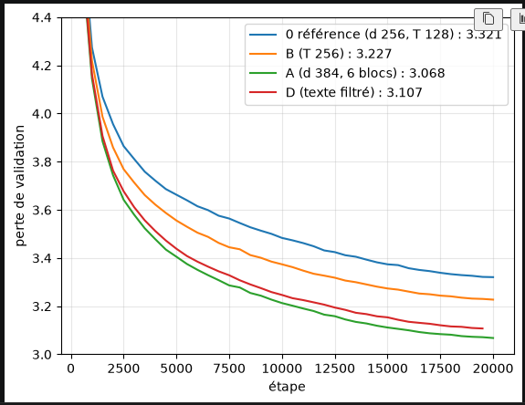

# notebooks — explorer sans tout relancer

## L'essentiel en 30 secondes

Un **notebook** (`.ipynb`) est un document fait de **cellules** : du texte ou du code. On exécute une cellule à la fois et le résultat (texte, graphique) s'affiche dessous. Les variables restent en mémoire : on change une cellule, on la relance, sans refaire le reste.

| | Script `.py` (nos leçons) | Notebook `.ipynb` |
|---|---|---|
| Usage | faire tourner de bout en bout | explorer, essayer, regarder |
| Exécution | tout d'un coup, dans le terminal | cellule par cellule |
| Reproductible | oui | moins (l'ordre des cellules compte) |
| Dans git | diff lisible | diff difficile (JSON) |

C'est pourquoi les leçons restent des scripts, et que les notebooks servent aux explorations.

## Exemple

[`01_comparer_les_courbes.ipynb`](01_comparer_les_courbes.ipynb) lit les CSV de `logs/` et trace la perte de validation de 0, B et A. Changer l'échelle (`plt.ylim`) et relancer une seule cellule suffit pour zoomer sur la fin des courbes.

Résultat obtenu (11 novembre 2026, avec D) :



Lecture : plus la courbe est basse, mieux c'est. A (verte) est la meilleure à 3,068. D (rouge, texte filtré) paraît un peu au-dessus de A, mais sur une validation filtrée elle est à égalité (voir `06_corpus/fiches/14_validation_filtree.md`). La courbe de D s'arrête à 19 500 : le CSV n'a pas sa dernière ligne.

## L'ouvrir

Dans VS Code : ouvrir le fichier `.ipynb`, choisir le noyau `.venv` (en haut à droite). Il faut le paquet `ipykernel` :

```bash
.venv/bin/pip install ipykernel
```

(Non listé dans `requirements.txt` : les leçons n'en ont pas besoin.)

## Ce qu'on en déduit

- Les notebooks sont utiles pour regarder des résultats (courbes, voisins d'embeddings, probabilités du token suivant) et pour essayer des idées vite.
- Un résultat que l'on veut garder devient un script numéroté dans `src/NN_*/scripts/`, avec sa fiche.
- Avant de commiter un notebook, vider ses sorties (images et textes générés peuvent être lourds ou contenir du texte de livres).
