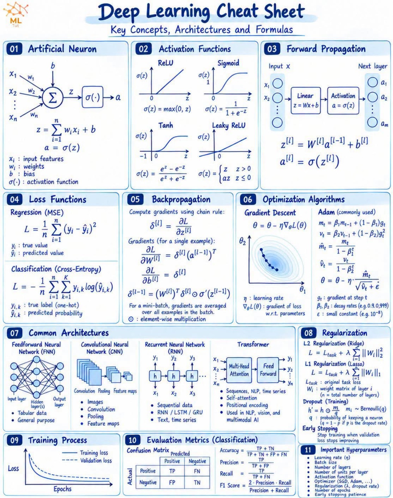

# 01 — Fondamentaux du deep learning

## Objectif global

Comprendre comment un réseau de neurones **apprend**, en le construisant soi-même, sans framework qui cache la mécanique : d'abord à la main avec NumPy, puis avec PyTorch.

Le fil rouge est un seul exemple : le **XOR**, appris par un réseau `[2, 4, 1]` (17 nombres à régler).

## À la fin de ce chapitre, on sait

- calculer la sortie d'un neurone et d'un réseau (propagation avant) ;
- mesurer son erreur (perte) et la faire baisser (rétropropagation, descente de gradient, Adam) ;
- choisir une activation et un optimiseur sur des critères mesurés ;
- faire la même chose avec PyTorch (autograd, `nn.Module`, `DataLoader`, GPU) ;
- vérifier qu'un réseau a vraiment appris, et pas seulement mémorisé (validation, arrêt anticipé).

## Parcours

| partie | leçons | thème |
|--------|--------|-------|
| `a_la_main/` (NumPy) | 01 à 08 | neurone, activations, propagation avant, perceptron, rétropropagation, entraînement, comparaison d'activations, Adam |
| `pytorch/` (PyTorch) | 09 à 11 | autograd et GPU, `nn.Module` et `DataLoader`, entraînement et validation |

## Organisation

- `scripts/` : les leçons, des scripts Python à lancer et à lire de haut en bas ;
- `fiches/` : une fiche `.md` par leçon (même nom), avec exemple chiffré, courbes et « Ce qu'on en déduit » ;
- `tools/` : les modules réutilisés par les leçons (`activations.py`, `forward.py`, `backpropagation.py`, `optimiseurs.py`…).

Lancement, depuis la racine du dépôt :

```bash
.venv/bin/python src/01_fundamentals/scripts/a_la_main/01_neurone.py
```

## Pourquoi ce chapitre

Un GPT est un réseau de neurones comme celui-ci, en beaucoup plus grand. Les mêmes idées (perte, gradient, optimiseur, validation) servent à l'entraîner. Ici on les comprend sur un cas assez petit pour tout voir.

## Pour illustrer : aide-mémoire du deep learning

Une page résume le chapitre : neurone, fonctions d'activation, propagation avant, perte, rétropropagation, Adam, régularisation et hyperparamètres (image externe, source MLTUT, non reproduite par nous).


