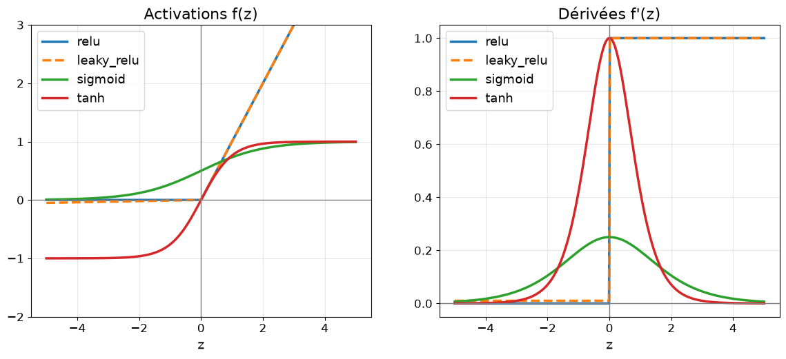

# Exercices : les fonctions d'activation

Cours associé : [`../../scripts/a_la_main/02_activations.py`](../../scripts/a_la_main/02_activations.py) (module : [`../../tools/activations.py`](../../tools/activations.py))

Pourquoi une activation ? Sans elle, empiler des couches revient à une seule opération linéaire. Elle ajoute la **non-linéarité**.
Pourquoi la dérivée ? La rétropropagation en a besoin pour savoir comment ajuster les poids.

## Exemple résolu

Valeurs de `z = −2, 0, 2` :

| activation | f(−2)  | f(0) | f(2)   | f'(−2) | f'(0) | f'(2) |
|------------|--------|------|--------|--------|-------|-------|
| relu       | 0      | 0    | 2      | 0      | 0     | 1     |
| leaky_relu | −0.02  | 0    | 2      | 0.01   | 0.01  | 1     |
| sigmoid    | 0.1192 | 0.5  | 0.8808 | 0.105  | 0.25  | 0.105 |
| tanh       | −0.964 | 0    | 0.964  | 0.0707 | 1     | 0.0707 |

## Les courbes

À gauche les fonctions, à droite leurs dérivées (relu en trait plein et leaky_relu en tirets, presque confondues).

## Ce qu'on en déduit

**Ce qu'on exige d'une activation** (on aurait pu en inventer bien d'autres : GELU, SiLU/Swish, softplus…)

1. **Non linéaire** : sinon, empiler des couches revient à une seule couche (`f(z) = 2z` est inutile).
2. **Dérivable (presque partout)** : la rétropropagation a besoin de la pente.
3. **Pente non nulle sur une bonne plage** : sinon l'apprentissage s'arrête.
4. **Peu coûteuse à calculer** : elle est appelée des milliards de fois.

**Pourquoi ces 4 dans ce projet** : chacune illustre un problème différent (saturation, centrage, neurone mort).

**Et pour le GPT** : on utilisera surtout **GELU** (proche de relu mais lisse) dans les couches cachées, et **softmax** en sortie. Elles s'ajouteront à `ACTIVATIONS` au moment du transformer.

## Comment choisit-on une activation ?

Surtout par **tâtonnement empirique** : les chercheurs testent, gardent ce qui entraîne bien, et la théorie arrive souvent après coup.

- Années 80-2000 : sigmoid et tanh.
- Vers 2011-2012 : relu s'impose (pas de gradient qui disparaît pour z > 0).
- 2016-2017 : GELU et SiLU/Swish, trouvées par expérimentation (Swish par recherche automatique).
- Aujourd'hui : les LLM récents (Llama…) utilisent **SwiGLU**, une variante de SiLU avec une « porte ».

Ce n'est donc **pas une courbe propre à chaque modèle** : une même activation sert dans plusieurs domaines (relu dans les réseaux d'images, GELU dans BERT, GPT-2 et dans les modèles d'images ViT).

Ce qui dépend vraiment de la tâche, c'est la **sortie** :
- sigmoid : une probabilité (2 classes) ;
- **softmax** : choisir parmi N possibilités (le prochain mot d'un LLM) ;
- aucune activation : prédire un nombre quelconque.

Les couches cachées sont plus interchangeables : le choix pèse sur la vitesse et la stabilité de l'entraînement, moins sur ce que le réseau peut apprendre.

**À retenir** : on choisit parmi des fonctions qui respectent les 4 critères, puis on **mesure**. C'est le principe du projet : changer une seule variable à la fois (ici l'activation) et comparer.

## Conclusions

- **sigmoid** : sortie dans (0, 1), utile pour une probabilité. Sa dérivée vaut au maximum 0.25 (en `z = 0`) et s'écrase vers 0 aux extrémités : le gradient « disparaît » si `|z|` est grand.
- **tanh** : sortie dans (−1, 1), centrée sur 0. Dérivée maximale 1 en `z = 0`, mais elle s'écrase aussi.
- **relu** : `max(0, z)`, simple et rapide, gradient 1 pour `z > 0`. Pour `z < 0`, gradient nul : le neurone peut « mourir » (ne plus apprendre).
- **leaky_relu** : comme relu, mais garde une petite pente (`alpha = 0.01`) pour `z < 0` : le gradient n'est jamais exactement nul.
- La dérivée de la sigmoïde s'écrit `σ(z)·(1 − σ(z))`. Vérification en `z = 0` : `0.5 × 0.5 = 0.25`.
