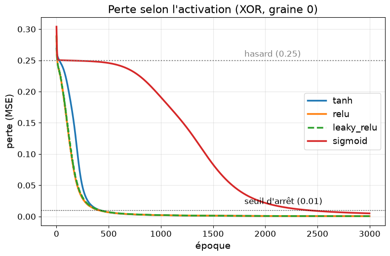

# Exercices : quelle activation choisir pour le XOR ?

Cours associé : [`../../scripts/a_la_main/07_comparer_activations.py`](../../scripts/a_la_main/07_comparer_activations.py) (module : [`../../tools/backpropagation.py`](../../tools/backpropagation.py))

Même exemple et même entraînement qu'à la fiche 06 (XOR, réseau `[2, 4, 1]`, MSE). On change **une seule chose** : l'activation de la couche cachée (fiche 02).

## La question

Quelle activation est la meilleure pour notre problème ? Deux critères :

1. le moins de **neurones morts** (un neurone mort ne sert plus à rien) ;
2. la **convergence la plus rapide** (le moins d'époques pour apprendre).

Le résultat dépend des poids de départ (aléatoires) : on refait donc l'entraînement **10 fois** par activation (graines 0 à 9).

## Résultat

| activation | réussites | époques (médiane) | neurones morts (moyenne) |
|------------|-----------|-------------------|--------------------------|
| **tanh** | **10/10** | 318 | **0** |
| relu | 7/10 | 277 | 1.5 |
| leaky_relu | 10/10 | 375 | 1.0 |
| sigmoid | 10/10 | 1838 | 0 |

(graine 0 : tanh, relu et leaky_relu descendent ensemble, relu et leaky_relu étant superposées ; sigmoid reste longtemps au niveau du hasard.)

## Le verdict : **tanh**

- **tanh** : réussit à chaque fois, aucun neurone mort, ~320 époques. Elle gagne sur les deux critères.
- **relu** : aussi rapide, mais elle a des neurones morts et **échoue 3 fois sur 10**.
- **leaky_relu** : ne bloque plus, mais certains essais prennent 4 000 à 6 800 époques.
- **sigmoid** : réussit, mais environ **6 fois plus lente**.

## Ce qu'on en déduit

- **Neurone mort** : `relu(z) = 0`, et sa dérivée aussi, pour `z ≤ 0`. Un neurone dont `Z` est négatif pour les 4 exemples ne reçoit plus aucun gradient (fiche 05) et ne change plus jamais. `tanh` et `sigmoid` ont toujours une pente non nulle : elles ne peuvent pas mourir.
- **Pourquoi relu échoue ici** : avec seulement 4 neurones cachés, en perdre 2 ne laisse pas assez de capacité pour le XOR.
- **Pourquoi sigmoid est lente** : sa pente est ≤ 0.25 (fiche 02), les corrections sont donc petites.
- **Un seul essai aurait trompé** : avec une seule graine, relu semble aussi bonne que tanh. Il faut plusieurs départs pour voir les échecs.
- **Pour le XOR, on garde tanh.** Ce choix vaut pour **ce petit réseau** : pour un GPT (milliards de paramètres), on choisira plutôt GELU ou SwiGLU (fiche 02), et on refera la même expérience sur le problème réel.
- **Règle du projet respectée** : une seule variable a changé, tout le reste est identique.
