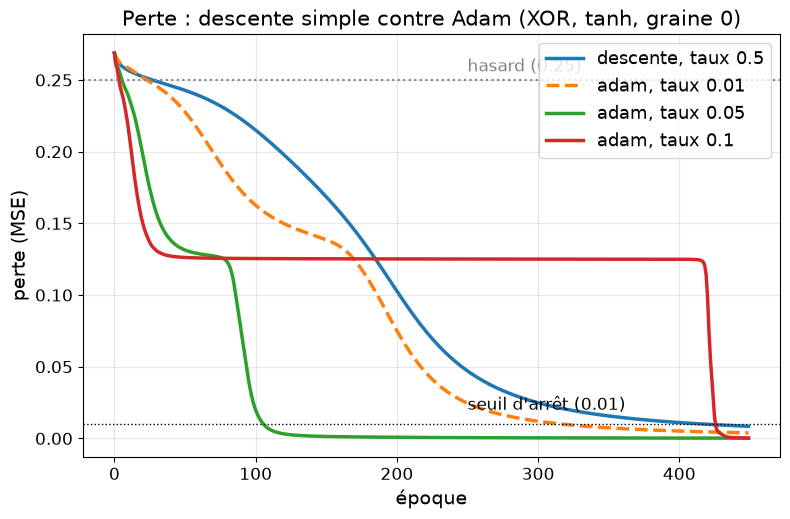

# Exercices : l'optimiseur Adam

Cours associé : [`../../scripts/a_la_main/08_adam.py`](../../scripts/a_la_main/08_adam.py) (module : [`../../tools/optimiseurs.py`](../../tools/optimiseurs.py))

Même XOR, même réseau `[2, 4, 1]`, même perte. On garde l'activation gagnante de la fiche 07 (`tanh`) et on change **une seule chose** : la règle de correction des poids.

## La question

Peut-on entraîner plus vite qu'avec la descente de gradient simple de la fiche 06 ?

## Deux règles de correction

| | règle | idée |
|---|-------|------|
| **descente** (fiche 06) | `poids = poids − taux × gradient` | même pas pour tous les poids, proportionnel au gradient du moment |
| **Adam** | `poids = poids − taux × m / √v` | chaque poids a son propre pas |

Dans Adam, `m` est la moyenne récente du gradient (la **direction**, comme de l'élan) et `v` la moyenne récente du gradient au carré (l'**échelle** de ce poids). Diviser par `√v` donne à chaque poids un pas de l'ordre de `taux`, quelle que soit la taille de son gradient. Adam est l'optimiseur standard pour entraîner les GPT.

## Résultat

Réseau `tanh`, 10 entraînements (graines 0 à 9) par réglage, arrêt sous 0.01 :

| optimiseur | réussites | époques (médiane) | pire cas |
|------------|-----------|-------------------|----------|
| descente, taux 0.5 | 10/10 | 318 | 418 |
| adam, taux 0.01 | 10/10 | 267 | 417 |
| **adam, taux 0.05** | **10/10** | **58** | **106** |
| adam, taux 0.1 | 10/10 | 31 | 426 |

(graine 0. Ici adam 0.1 reste coincé sur un plateau, 0.125, pendant 400 époques : c'est le « pire cas » de 426. Avec les autres graines, il passe sous le seuil en 22 à 80 époques.)

Autres activations (taux Adam 0.05) :

| activation + optimiseur | réussites | médiane | pire cas |
|-------------------------|-----------|---------|----------|
| sigmoid + descente | 10/10 | 1838 | 2443 |
| sigmoid + adam | 10/10 | 99 | 135 |
| relu + descente | 7/10 | 277 | 406 |
| relu + adam | **5/10** | 63 | 75 |

## Le verdict : **tanh + Adam, taux 0.05**

~60 époques au lieu de ~320, soit environ **5 fois plus vite**, sans aucun échec.

## Ce qu'on en déduit

- **Adam accélère beaucoup** : pas besoin de régler à la main un pas adapté à chaque poids.
- **Le taux compte encore.** 0.01 est trop prudent (267 époques) ; 0.1 est le plus rapide en général mais peut rester coincé sur un plateau ; 0.05 est le meilleur compromis ici. Adam ne dispense pas de choisir un taux raisonnable.
- **sigmoid devient correcte avec Adam** : 1838 → 99 époques (~18 fois plus vite). Son défaut (pente faible) est en grande partie compensé par Adam, qui agrandit les pas des poids dont le gradient est petit.
- **Adam ne règle pas les neurones morts, il les aggrave** : relu passe de 3 échecs à **5 échecs sur 10**. Les pas d'Adam sont grands dès le début, ce qui tue plus de neurones, et un neurone mort a un gradient nul que même Adam ne peut pas réveiller. Le choix de l'activation (fiche 07) reste donc indépendant du choix de l'optimiseur.
- **Lien avec le GPT** : les LLM s'entraînent avec Adam (souvent la variante AdamW), avec un taux qui varie au cours de l'entraînement. C'est la même boucle que la fiche 06, seule la règle de correction change.
- **Règle du projet respectée** : une seule variable a changé (l'optimiseur, puis son taux), tout le reste est identique.
