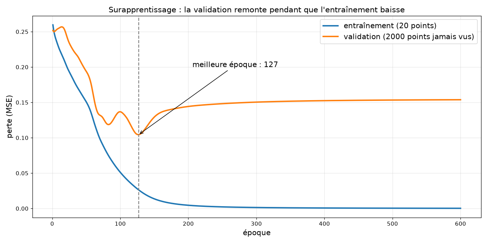

# Exercices : entraînement et validation

Cours associé : [`../../scripts/pytorch/11_validation.py`](../../scripts/pytorch/11_validation.py)

Même réseau `[2, 4, 1]` (`tanh` puis `sigmoid`), toujours le XOR. Mais une question reste ouverte depuis la fiche 06 : on a mesuré l'erreur sur les 4 **mêmes** exemples que ceux de l'entraînement. Le réseau a-t-il **compris** le XOR, ou a-t-il appris ses 4 réponses **par cœur** ?

## L'idée : un examen avec des questions jamais vues

Comme un élève qui révise : s'il ne connaît que les corrigés par cœur, il réussit les exercices d'entraînement mais échoue à l'examen.

| jeu de données | rôle | utilisé pour corriger les poids ? |
|----------------|------|----------------------------------|
| **entraînement** | les exercices de révision | oui |
| **validation** | l'examen | **jamais** : on mesure seulement |

## Le XOR « en continu »

Pour avoir de quoi tester, les entrées ne sont plus seulement 0 ou 1 : ce sont des points quelconques du carré [0, 1]². La réponse vraie reste le XOR : 1 si une seule des deux coordonnées dépasse 0,5, sinon 0.

- **Entraînement** : 20 points, dont certains avec une étiquette fausse (10 % d'erreurs, comme des erreurs de saisie dans de vraies données).
- **Validation** : 2000 points, tous justes.

## Résultat

Perte (MSE) selon l'époque, graine 0 :

| époque | entraînement | validation |
|--------|--------------|------------|
| 1 | 0,2596 | 0,2519 |
| 50 | 0,1508 | 0,1939 |
| 100 | 0,0511 | 0,1367 |
| **127** | 0,03 | **0,1044** (le minimum) |
| 200 | 0,0046 | 0,1443 |
| 400 | 0,0007 | 0,1525 |
| 1500 | 0,0000 | 0,1558 |

- **L'entraînement baisse jusqu'à 0** : le réseau finit par connaître les 20 points, y compris l'étiquette fausse.
- **La validation baisse, puis remonte** : après l'époque 127, le réseau apprend le bruit de ses 20 points au lieu du vrai XOR. C'est le **surapprentissage**.

## L'arrêt anticipé

On garde les poids de l'époque où la perte de validation est la plus basse (ici 127), plutôt que ceux de la fin.

Réponses justes sur les 2000 points de validation, graine 0 : **85,2 %** en s'arrêtant à l'époque 127, contre **81,8 %** après 1500 époques.

Sur 10 graines :

| graine | meilleure époque | précision à cette époque | précision à 1500 |
|--------|------------------|--------------------------|------------------|
| 0 | 127 | 85,2 % | 81,8 % |
| 1 | 175 | 82,6 % | 78,5 % |
| 2 | 112 | 88,8 % | 79,1 % |
| 3 | 1500 | 87,3 % | 87,3 % |
| 4 | 170 | 85,6 % | 70,2 % |
| 5 | 106 | 81,4 % | 82,8 % |
| 6 | 147 | 87,6 % | 84,1 % |
| 7 | 269 | 79,9 % | 72,5 % |
| 8 | 143 | 88,7 % | 83,6 % |
| 9 | 332 | 82,1 % | 82,8 % |

Meilleure époque médiane : **158**. Gain moyen de précision grâce à l'arrêt : **+4,6 points**.

## Ce qu'on en déduit

- **Une perte d'entraînement basse ne prouve rien.** Elle tombe à 0 alors que le réseau se trompe sur 15 à 20 % des points neufs. La seule mesure fiable est celle faite sur des données jamais vues.
- **Surveiller les deux courbes.** Si l'entraînement baisse et que la validation remonte, on arrête : plus d'entraînement ne fait qu'apprendre le bruit.
- **Le bon moment varie** : de l'époque 106 à 332 selon la graine (une fois, jamais : la graine 3 continue de s'améliorer). On le trouve en regardant la validation, pas en fixant un nombre d'époques à l'avance. Ça ne marche pas à tous les coups : pour les graines 5 et 9, s'arrêter tôt est très légèrement moins bon.
- **Le surapprentissage vient du manque de données.** Avec 20 points, le réseau a trop de liberté (17 nombres pour 20 exemples). Avec beaucoup plus de points, l'écart se réduirait. C'est pourquoi un GPT a besoin de très grands corpus.
- **Lien avec le GPT** : on découpera de même nos textes en deux parties, entraînement et validation. Le chapitre `04_training` surveillera ces deux pertes pour décider quand arrêter, et pour comparer nos corpus (français, technique, mixte) sur des textes qu'aucun modèle n'a vus.
