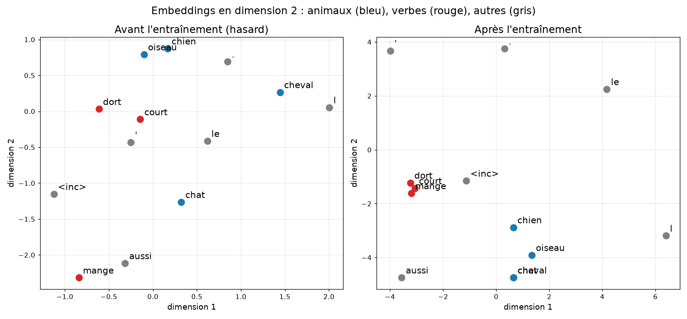

# Leçon 4 : les embeddings

Script : [`04_embeddings.py`](../scripts/04_embeddings.py)
Lancement : `.venv/bin/python src/02_tokenizer/scripts/04_embeddings.py`

## Le corpus utilisé

Fichier : [`corpus_animaux.txt`](../corpus_animaux.txt) (15 phrases, 67 tokens en mots, vocabulaire de 13 tokens dont `<inc>`).

> le chat dort. le chien dort. le cheval dort. l'oiseau dort. le chat mange. le chien mange. le cheval mange. l'oiseau mange. le chat court. le chien court. le cheval court. le chat dort aussi. le chien mange aussi. l'oiseau court aussi. le cheval dort aussi.

Ici : 4 animaux (chat, chien, cheval, oiseau) suivis de 3 verbes (dort, mange, court). C'est ce qui permet aux animaux de se rapprocher.

## Pourquoi cette leçon ?

Après le tokenizer, un texte est une suite d'**identifiants** (`chat` = 4, `chien` = 6).
Mais 4 et 6 ne veulent rien dire : « 5 » (`cheval`) n'est pas « entre » les deux.
Le one-hot (leçon 1) règle ce défaut, mais met **tous les mots à égale distance**.

Un **embedding** est un petit vecteur de nombres **appris**, un par token.
Les mots qui s'utilisent de la même façon finissent avec des vecteurs proches.

| Représentation | `chat` | Sens ? |
|---|---|---|
| Identifiant | `4` | aucun |
| One-hot | `[0,0,0,0,1,0,…]` (13 nombres) | aucun, tous équidistants |
| Embedding (dim 2) | `[0.32, -1.26]` au départ, appris ensuite | oui |

## Comment ça marche

- Une table `E` de forme (vocabulaire, dimension) : ici **13 × 2**.
- Embedding du token `i` = **ligne `i`** de `E` (équivaut à `one-hot @ E`, en plus rapide).
- `E` est un paramètre comme `W1` : on la corrige par rétropropagation.
- Tâche d'entraînement : **prédire le mot suivant** (celle d'un GPT).
- La **perte** (cross entropy) vaut −log(probabilité donnée au vrai mot suivant). Détail dans `04_training`.
- Le **cosinus** mesure la ressemblance de direction : 1 = même, 0 = sans rapport, −1 = opposés.

## Résultats (graine 0, dimension 2, Adam 0,05, 600 époques)

| Paire | Avant | Après |
|---|---|---|
| chat ~ chien | −0,91 | **+1,00** |
| chat ~ oiseau | −0,99 | **+0,98** |
| dort ~ mange | +0,29 | **+0,99** |
| chat ~ dort | −0,30 | +0,22 |

Perte : 3,163 (époque 1) → 0,887 (50) → 0,688 (150) → 0,680 (600).
Voisins de `chat` : cheval, chien, oiseau, aussi.

## Ce qu'on en déduit

- **Le sens naît de l'usage** : personne n'a dit que chat, chien, oiseau sont des animaux. Ils sont suivis des mêmes mots (dort, mange, court), donc leurs vecteurs se rapprochent.
- **La perte ne tombe pas à 0** : après `chat`, trois mots sont possibles. Le meilleur modèle ne peut qu'estimer des probabilités (0,68 est proche du minimum possible ici).
- **Dimension 2 = on voit tout**, mais un vrai GPT en utilise des centaines (768 pour GPT-2).
- **Coût** : l'embedding pèse vocabulaire × dimension. Avec 50 000 × 768, c'est 38 millions de nombres, d'où un vocabulaire modeste pour la GTX 1070.
- Les résultats varient avec la graine (par exemple chat ~ dort passe de +0,22 à −0,79), mais « animaux ensemble, verbes ensemble » se retrouve à chaque fois.

## Plus tard : que reprend-on du XOR pour le vrai mini-GPT ?

(Un « labo » = un chapitre du plan, un dossier de `src/` : `01_fundamentals` = XOR à la main puis PyTorch, `02_tokenizer` = cette leçon, `03_transformer` = construire le GPT, `04_training` = l'entraîner. Les deux derniers ne sont pas encore écrits.)

L'embedding sera la première couche du mini-GPT. Son entraînement, dans `04_training`, reprend ce qu'on a vu dans `01_fundamentals` :

| Vu dans `01_fundamentals` (XOR) | Dans `04_training` (mini-GPT) |
|---|---|
| **Adam** (leçon 8) | On utilise **AdamW**, un Adam qui gère mieux la régularisation (pénalité sur les poids trop grands). Même principe de base. |
| **Rétropropagation / autograd** (leçons 5 et 9) | Oui : `loss.backward()`, sur un réseau bien plus grand. |
| **Boucle d'entraînement, validation, arrêt anticipé** (leçons 6 et 11) | Oui : même boucle, avec des batchs et une perte de validation. |
| **`nn.Module`, `DataLoader`** (leçon 10) | Oui : le GPT sera un `nn.Module`. |
| **Cross entropy** (cette leçon) | Oui : c'est la perte du mini-GPT. |
| **tanh** | En général non : un Transformer utilise plutôt **GELU** (proche de ReLU, plus lisse). Le verdict « tanh gagne » valait pour le petit XOR ; seul le principe reste : tester plusieurs activations en ne changeant qu'une variable. |

## Et ensuite ?

Leçon 5 : fabriquer les **séquences d'entraînement** (fenêtre de contexte, entrées et cibles décalées d'un token).
