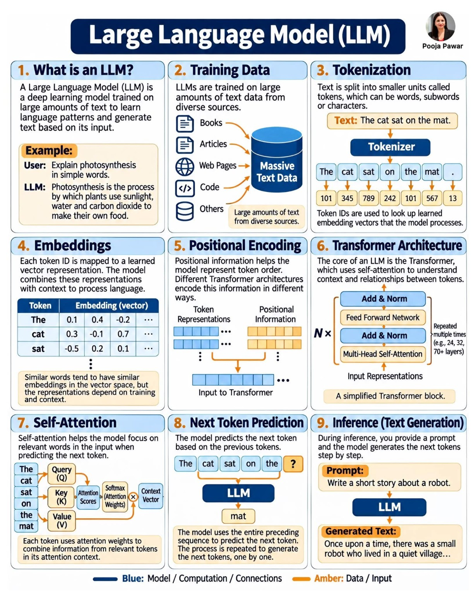

# 03 — Construire un Transformer

## Le sigle GPT

**G**enerative (il génère du texte mot après mot) · **P**re-trained (pré-entraîné à prédire le mot suivant sur un grand corpus) · **T**ransformer (l'architecture, objet de ce chapitre).

## Objectif global

Programmer progressivement l'architecture qui est le cœur d'un GPT, en rendant explicites toutes ses opérations.

## À la fin de ce chapitre, on saura

- programmer une attention simple et afficher ses scores ;
- ajouter un masque causal (un token ne voit pas le futur) ;
- construire une tête d'attention, puis plusieurs têtes ;
- assembler un bloc Transformer (feed forward, connexions résiduelles, normalisation) ;
- empiler des blocs pour former un petit GPT.

## Parcours

| Leçon | Sujet | État |
|---|---|---|
| 1 | attention simple (scores, softmax, mélange) | fait |
| 2 | masque causal | fait |
| 3 | Query, Key, Value | fait |
| 4 | positions (l'ordre des mots) | fait |
| 5 | plusieurs têtes | fait |
| 6 | bloc Transformer | fait |
| 7 | petit GPT complet | fait |

## Organisation

`scripts/` (scripts), `fiches/` (fiches `.md`), `tools/` (`attention.py`, `transformer_block.py`, `gpt.py`).

Lancement : `.venv/bin/python src/03_transformer/scripts/01_attention_simple.py`

## Prérequis

Chapitres `01_fundamentals` (réseaux, PyTorch) et `02_tokenizer` (texte en identifiants).

## Pour illustrer : l'architecture d'un LLM

Les blocs 4 à 7 (embeddings, encodage de position, bloc Transformer, auto-attention Q/K/V) sont exactement ce qu'on construit ici (image externe, auteure Pooja Pawar, non reproduite par nous). La page « Common Architectures » du Deep Learning Cheat Sheet situe le Transformer parmi les autres réseaux ([voir le chapitre 01](../01_fundamentals/README.md)).

