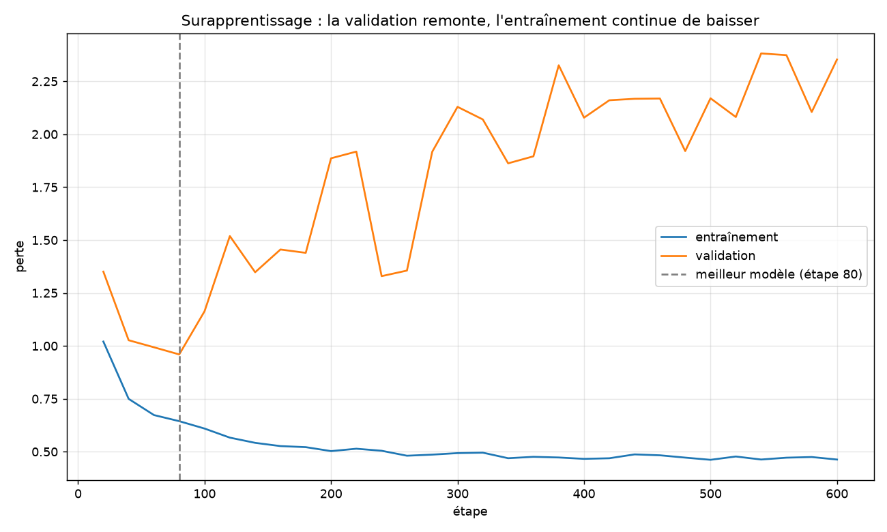
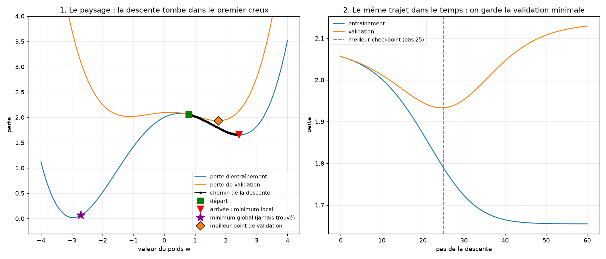

# Leçon 3 : checkpoints, meilleur modèle, métriques

Script : [`03_checkpoints.py`](../scripts/03_checkpoints.py)
Code : [`tools/checkpoint.py`](../tools/checkpoint.py)
Lancement : `.venv/bin/python src/04_training/scripts/03_checkpoints.py`

## L'essentiel en 30 secondes

Leçon 2 : la validation était la meilleure vers l'étape 100, puis elle **remontait**. Mais on ne gardait que le **dernier** modèle, le moins bon. Et si le script s'arrête, tout disparaît.

**Comme réviser un examen.** L'entraînement, ce sont les exercices que tu connais ; la validation, ce sont des questions **jamais vues**. Au début, plus tu révises, mieux tu réussis les deux. À partir d'un moment, tu apprends les réponses **par cœur** : tu réussis de mieux en mieux les exercices connus, mais tu rates les nouvelles questions. La perte de validation remonte (une perte est une erreur : plus elle est basse, mieux c'est).

| Étape | Perte train | Perte validation |
|---|---|---|
| 100 | 0,61 | **1,16** (le mieux) |
| 600 | 0,46 | 2,35 (bien pire) |

Le modèle de l'étape 100 comprenait mieux ce qu'il n'a jamais vu que celui de l'étape 600, qui a appris par cœur. À la fin du script de la leçon 2, on ne gardait que celui de l'étape 600, et aucun fichier n'était écrit : tout s'effaçait.

| Notion | Rôle |
|---|---|
| **checkpoint** | un fichier avec les poids, pour ne pas perdre un modèle entraîné |
| **meilleur modèle** | on mesure la validation souvent ; chaque **record** déclenche une sauvegarde |
| **métriques** | les pertes sont écrites dans un fichier (`logs/`) pour tracer la courbe après coup |

C'est l'**arrêt anticipé** de `01_fundamentals` (leçon 11), appliqué au GPT.

## Ce que contient un checkpoint

| Contenu | Pourquoi |
|---|---|
| `poids` | tous les paramètres (le « cerveau ») |
| `config` | vocabulaire, `d`, têtes, blocs, `T_max` : de quoi **reconstruire la forme** du modèle avant d'y remettre les poids |
| `etape`, `perte_val` | où l'on en était |
| `optimiseur` (optionnel) | l'état d'AdamW, pour **reprendre** l'entraînement là où il s'est arrêté |

Recharger = reconstruire le modèle avec la `config`, puis y copier les `poids`.

## Ce qu'on a lancé

600 étapes, mesure toutes les 20 étapes. Fichiers écrits :

| Fichier | Contenu |
|---|---|
| `models/checkpoints/animaux_meilleur.pt` | meilleur modèle (étape 80) |
| `models/checkpoints/animaux_dernier.pt` | modèle de l'étape 600 |
| `logs/entrainement_animaux.csv` | étape, perte train, perte validation (30 lignes) |

| Modèle | Perte train | Perte validation | Génération depuis `le chat` |
|---|---|---|---|
| **meilleur** (étape 80) | 0,644 | **0,960** | `le chat dort . le cheval dort . le chat` |
| dernier (étape 600) | 0,463 | 2,353 | `le chat dort . le chien dort . le cheval` |

Le modèle rechargé depuis le fichier redonne exactement la même validation (0,960).

## Minimum local et meilleur checkpoint : deux idées différentes

Jouet à **un seul poids** `w` (un vrai GPT en a des milliers, impossible à dessiner).

| | Cherche | Mesuré sur | Outil |
|---|---|---|---|
| **Entraînement** | le creux de la perte d'entraînement | données d'entraînement | gradient, AdamW |
| **Meilleur checkpoint** | le moment où le modèle généralise le mieux | données de validation | arrêt anticipé |

- **Figure 1** : la descente part de `w = 0,8` (carré vert) et tombe dans le **premier creux** rencontré (triangle rouge, `w = 2,43`) : un **minimum local**. Le creux bien plus profond à gauche (étoile violette, `w = -2,7`, perte quasi nulle) n'est jamais trouvé : la descente ne voit que la pente autour d'elle.
- **Figure 2** : le même trajet dans le temps. La perte d'entraînement descend sans cesse, la validation passe par un minimum au **pas 25** (losange orange) puis remonte. Le checkpoint garde ce pas-là, pas l'arrivée.

L'entraînement **cherche** dans le paysage des poids. Le checkpoint **choisit** parmi les modèles déjà visités, avec une mesure indépendante. Les deux effets s'additionnent : on peut finir dans un minimum local **et** avoir appris par cœur.

## Ce qu'on en déduit

- Sans checkpoint, un modèle entraîné **disparaît** à la fin du script.
- Le dernier modèle est **rarement le meilleur** : l'entraînement continue de baisser, la validation remonte.
- Le meilleur est moins bon sur l'entraînement mais **meilleur sur ce qu'il n'a jamais vu** : c'est ce qu'on veut.
- La courbe de validation est **en dents de scie** : elle ne compte que 7 mots, donc elle est bruitée. Un vrai corpus la lissera.
- Un fichier de métriques permet de comparer des expériences **sans les relancer** (essentiel pour le plan d'expériences A à D de `docs/Readme.md`).
- Chaque `.pt` pèse environ 350 Ko ; ce sont des fichiers binaires, à ne pas commiter sans réfléchir (voir `.gitignore`).

## Et ensuite ?

Le chapitre est bouclé sur un mini-corpus. Reste `05_inference` (génération réglable : température, `top_p`…) et, plus tard, un **vrai corpus** (`datasets/`) pour un modèle plus grand.
