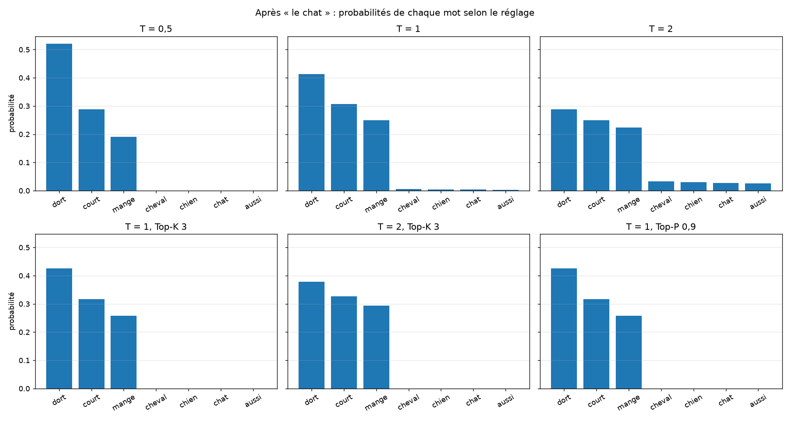

# Leçon 2 : température, Top-K, Top-P

Script : [`02_echantillonnage.py`](../scripts/02_echantillonnage.py)
Code : [`tools/generation.py`](../tools/generation.py)
Lancement : `.venv/bin/python src/05_inference/scripts/02_echantillonnage.py`

## L'essentiel en 30 secondes

Trois réglages agissent sur les probabilités **avant le tirage**. Les poids du modèle ne changent pas.

| Réglage | Ce qu'il fait | Effet |
|---|---|---|
| **Température** `T` | divise les scores par `T` avant le softmax | `T` < 1 : le favori domine ; `T` > 1 : probabilités aplaties |
| **Top-K** | ne garde que les `K` mots les plus probables | « on ne tire qu'entre les K favoris » |
| **Top-P** (noyau) | garde les mots les plus probables jusqu'à cumuler `p` | « les mots qui font 90 % des chances à eux tous » |

**Renormaliser** : après avoir mis à 0 les mots écartés, on divise par la somme restante pour que le total refasse 100 %.

**Top-P contre Top-K** : Top-K garde toujours `K` mots. Top-P **adapte** : si le modèle est sûr de lui, 1 mot suffit ; s'il hésite, on en garde plusieurs.

**Pourquoi filtrer ?** Le tirage pur peut choisir un mot très improbable (rare, mais sur des centaines de mots ça arrive) et le texte déraille. Top-K et Top-P coupent cette « queue ».

## Ce qu'on a lancé

Prompt `le chat`.

| Réglage | dort | court | mange | cheval | chien |
|---|---|---|---|---|---|
| T = 0,5 | 52,1 % | 28,9 % | 19,0 % | 0,0 % | 0,0 % |
| T = 1 | 41,3 % | 30,8 % | 25,0 % | 0,5 % | 0,4 % |
| T = 2 | 28,9 % | 24,9 % | 22,4 % | 3,3 % | 2,9 % |
| Top-K 2 | 57,3 % | 42,7 % | écarté | écarté | écarté |
| Top-P 0,8 | 42,6 % | 31,7 % | 25,7 % | écarté | écarté |

Top-P (0,9) garde un nombre de mots qui **s'adapte** :

| Après | Mots gardés | Favori |
|---|---|---|
| `le chat` | 3 | 41 % |
| `le chat dort` | 2 | 71 % |
| `le chat dort .` | 1 | 95 % |

2000 tirages après `le chat` (part de **vrais verbes** : dort, mange, court) :

| Réglage | Vrai verbe | Mots distincts tirés |
|---|---|---|
| T = 0,5 | 100 % | 3 |
| T = 1 | 97,4 % | 13 |
| T = 2 | **77,5 %** | 13 |
| T = 1, Top-K 3 | 100 % | 3 |
| T = 2, Top-K 3 | 100 % | 3 |
| T = 1, Top-P 0,9 | 100 % | 3 |

## Ce qu'on en déduit

- **Température haute** : plus de variété, mais aussi des mots absurdes (22,5 % de non-verbes à `T = 2`).
- **Température basse** : sûr, mais répétitif, et on tend vers le glouton.
- **Top-K et Top-P** coupent les mots improbables : à `T = 2`, Top-K 3 redonne 100 % de vrais verbes.
- Dans ce petit modèle, Top-K 3 et Top-P 0,9 donnent le même résultat. Sur un grand vocabulaire, la différence se voit : Top-P s'adapte, Top-K non.
- Ces réglages se combinent. C'est ce qu'exposent les API (`temperature`, `top_p`).
- Mesure à faire **sur beaucoup de tirages** : un seul essai ne prouve rien.

## Et ensuite ?

Comparer plusieurs modèles sur les mêmes prompts (meilleur et dernier checkpoint, puis des corpus différents), pour relier la qualité du texte à la perte de validation.
