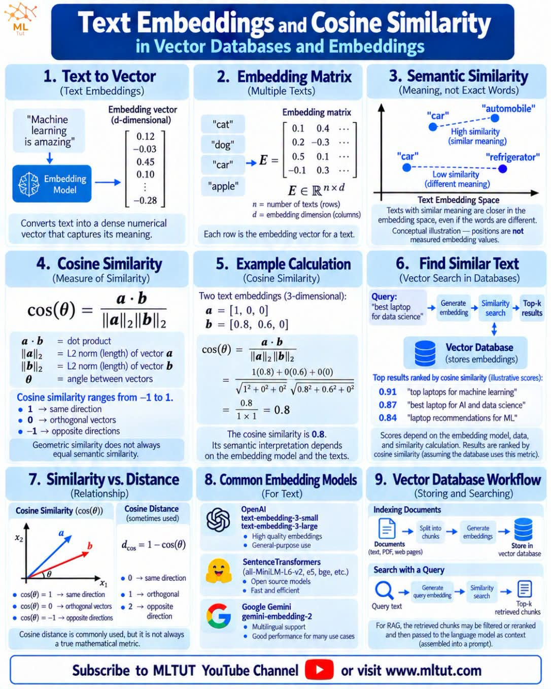
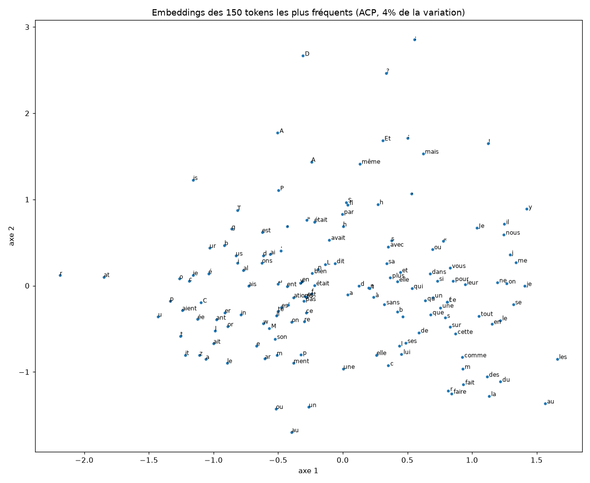
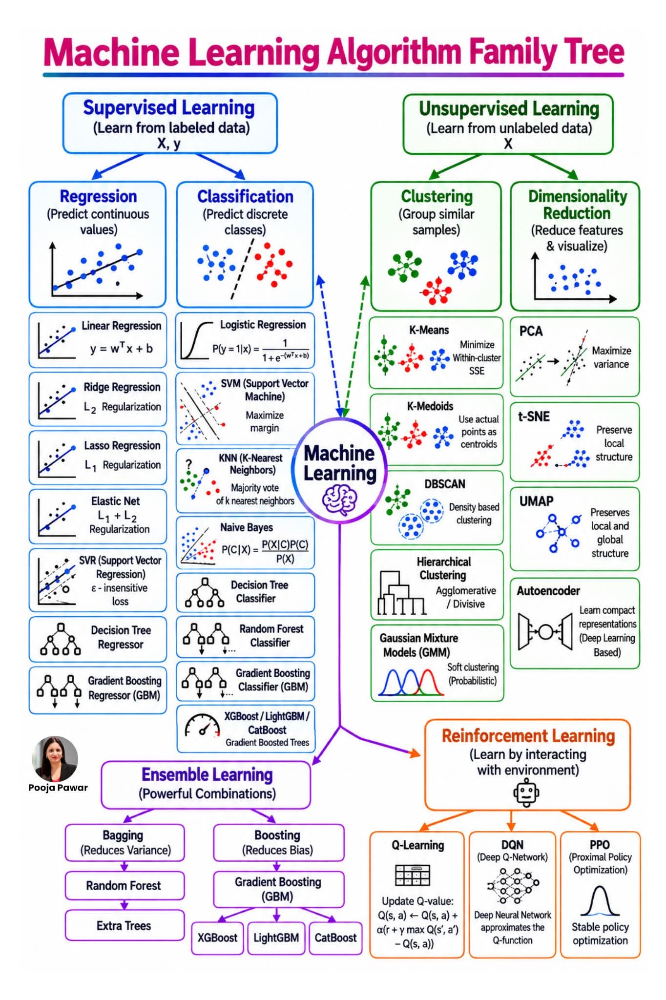

# 13 — Ce que le modèle a mis dans ses embeddings

Script : [`../scripts/13_embeddings.py`](../scripts/13_embeddings.py)

## L'essentiel en 30 secondes

- Chaque token a un **embedding** : une ligne de 256 nombres dans une table de 4 612 lignes. Au départ ces nombres sont aléatoires.
- Personne n'a dit au modèle ce que veut dire un mot. Si deux tokens ont des vecteurs proches à la fin, c'est que l'entraînement les a rapprochés : ils servent dans les mêmes contextes.
- On mesure la proximité avec le **cosinus** : 1 = même direction, 0 = sans rapport, -1 = opposés.
- Sur notre petit modèle, le signal est là mais faible (cosinus de 0,2 à 0,3).

## La similarité cosinus

Pour deux vecteurs `a` et `b` : `cos(a, b) = (a · b) / (|a| × |b|)`.

Exemple à la main : `a = [1, 0]`, `b = [0.8, 0.6]`. Alors `a · b = 0.8`, `|a| = 1`, `|b| = 1`, donc `cos = 0.8`.

Au hasard, deux tokens ont un cosinus moyen de **0,001** (écart 0,065) : en 256 dimensions, deux directions tirées au hasard sont presque indépendantes. Un cosinus de 0,25, quatre fois l'écart, n'est donc pas un hasard.

Aide-mémoire illustrant les embeddings, le cosinus et la recherche de textes proches (image extraite d'un réseau social, source MLTUT, non reproduite par nous) :

## Ce qu'on observe (sortie dans `logs/embeddings_sortie.txt`)

| Token | Voisins trouvés | Verdict |
|---|---|---|
| ` nuit` / ` jour` | proches l'un de l'autre (0,26) | sens opposés mais même usage : bon signe |
| ` homme` | ` femmes` 0,28, ` hommes` 0,24 | pluriel et genre rapprochés |
| `2` | `3` 0,31, `4` 0,30, `5` 0,27 | les chiffres forment un groupe |
| ` triste` | ` étrange` 0,28, ` sombre`, ` pauvre` | adjectifs |
| ` chien`, ` bleu`, ` heureux` | du bruit (` o`, `ᶆ`, ` Là`) | rien d'appris |
| roi − homme + femme | `ń`, ` DE`... | l'analogie rate |

## L'ACP : une carte qui perd presque tout

L'ACP (analyse en composantes principales) cherche les deux directions où le nuage de points varie le plus. Ici elles ne gardent que **4 %** de la variation : sur 256 dimensions, deux axes ne suffisent pas. La carte `logs/embeddings_acp.png` montre donc surtout un nuage mal organisé. À ne pas sur-interpréter.

Notre figure (150 tokens les plus fréquents) :

Pour situer l'ACP parmi les autres méthodes (réduction de dimension : PCA, t-SNE, UMAP ; regroupement : k-means, DBSCAN), voici une carte des familles d'algorithmes (image d'un réseau social, auteure Pooja Pawar) :

## Ce qu'on en déduit

- **Pourquoi des embeddings** : un entier (« 42 ») ne dit rien. Un vecteur peut être proche ou éloigné d'un autre, et l'entraînement sait le déplacer petit à petit.
- **Pourquoi le résultat est faible** : 5,6 M de paramètres et 30 minutes d'entraînement. Les grands modèles sont bien meilleurs sur les analogies, et les mots rares (` chat` est découpé en plusieurs tokens) ne sont pas appris du tout.
- **Les tokens rares** (`ʹ`, `ħ`, `가`) apparaissent comme voisins : leurs vecteurs ont à peine bougé depuis le hasard, donc ils ressemblent à tout un peu. C'est un argument pour le filtrage de l'expérience D (leçon 11).
- **Alternatives existantes** : word2vec et GloVe n'apprennent que ces vecteurs ; ici ils sont appris en même temps que le reste du GPT.
- **Lien avec la suite** : la moyenne des embeddings des tokens d'un livre donne un vecteur par livre. On pourra ainsi regrouper les 346 livres par genre (carte de la bibliothèque), avec la même ACP ou un k-means.
